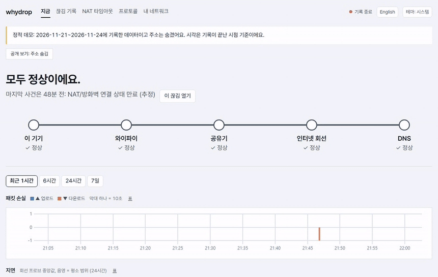

[English](README.md) | **한국어**

# 와이파이 탓일까, 공유기 탓일까, 통신사 탓일까 — 그리고 패킷에는 무슨 일이 있었을까?

[](https://github.com/YHK0427/whydrop/actions/workflows/ci.yml)  

whydrop은 집 인터넷을 위한 셀프호스트 블랙박스예요. TCP와 UDP로 1초마다 확인하기 때문에 3초짜리 끊김도 잡도록 만들었고, 끊길 때마다 경로의 **어디서** 끊겼는지, **추정 원인**이 무엇인지, 그동안 TCP와 UDP가 무엇을 했는지 알려 줘요.

[](https://yhk0427.github.io/whydrop/)

이런 판정을 내려요(원인 이름과 다음 할 일은 대시보드의 실제 문구, 시간은 예시):

> **ISP 구간의 회선 끊김 (추정)** — 인터넷 회선, 46초. *내보내기로 증거를 저장하고 통신사에 문의하세요.*
>
> **와이파이 문제 (추정)** — 와이파이, 4초. *신호가 약했다면 AP 위치나 채널을 바꾸세요. AP가 사라졌다면 전원을 확인하거나 재부팅하세요.*
>
> **NAT/방화벽 연결 상태 만료 (추정)**. *유휴 간격이 측정된 NAT 타임아웃보다 길어요. keepalive를 그보다 짧게 설정하세요.*

끊김 페이지에는 증거가 더 붙어요. 어느 방향에서 패킷이 사라졌는지, 그동안 공유기는 어땠는지, TCP는 무엇을 했는지.

**[라이브 데모](https://yhk0427.github.io/whydrop/)**: 실제로 이틀 동안 기록하고 일부러 장애를 넣은 데이터를 대시보드 공개 보기로 보여 줘요(읽기 전용, 시간은 기록 시점 기준).

## 빠른 시작

```sh
git clone https://github.com/YHK0427/whydrop && cd whydrop
docker compose up -d
docker compose logs whydrop | grep dashboard     # 출력된 링크를 여세요(토큰이 들어 있어요)
docker compose exec whydrop cat /data/ui-token   # 나중에 토큰 다시 보기(로그에는 처음 만들 때만 나와요)
```

이게 기본 모드예요. 계정도, 서버도, 설정도 필요 없어요. 계속 켜져 있으면서 확인하고 싶은 인터넷을 쓰는 기기(홈서버, 라즈베리 파이, Docker가 되는 NAS)에서 돌리세요. 업로드/다운로드 구분과 TCP 연결 분석이 필요하면 [정밀 모드](#정밀-모드)를 더하세요.

## 알려 주는 것

- **어디서 끊겼는지**, 구간별로: *이 기기 → 와이파이 또는 유선 → 공유기 → 인터넷 회선 → DNS*. 대시보드는 이 경로를 케이블로 그리고, 끊긴 구간에서 케이블이 눈에 띄게 끊어져요.
- **추정 원인**: [docs/design](docs/design.ko.md)에서 읽을 수 있는 규칙으로 정해요. 와이파이 문제, 유선 연결, 이 기기의 네트워크 설정, 공유기, 공인 IP 변경, NAT 상태 유실·초기화, DNS(공유기, 통신사, 공개 DNS 차단, 또는 전부), 통신사 구간의 회선 끊김, 손실이 많은 회선, 대기열. 모든 판정에는 "추정"이 붙어요. whydrop은 추론할 뿐 확신하지 않아요.
- **다음에 할 일**: 원인마다 한 문장.
- **끊김은 아닌 불안정 구간**: 패킷 손실, 대기열 때문에 높아진 지연, 약한 와이파이 신호, 와이파이와 공유기 사이의 손실.
- **넘겨줄 수 있는 증거**: 상담 채팅에 붙여 넣을 텍스트 요약, CSV/JSON 내보내기, 카드 이미지, 주소를 지운 공개 보기 버그 리포트.

판정 방식(서로 다른 제공자들의 쿼럼, 무작위 손실을 끊김으로 부르지 않는 게이트, 원인을 확정하기 전 80초 정착)은 [docs/how-it-works](docs/how-it-works.ko.md)에 있어요.

## 정밀 모드

기본 모드는 "답이 왔다/안 왔다"만 볼 수 있어요. **reflector**(아무 저렴한 VPS에서 도는 작은 whydrop 프로세스, 무료 티어로 충분해요)가 있으면 agent가 이것들을 더해요.

- **udp_stream**: 순번이 붙은 UDP 패킷을 1초에 10개 보내요. reflector가 받은 것을 알려 주니까, 사라진 패킷마다 **업로드인지 다운로드인지** 가려요.
- **hot TCP 연결**: 1초마다 하트비트를 보내요. 끊긴 동안 TCP 자신이 한 일을 볼 수 있어요. 멈춤, RTO가 두 배씩 늘며 재전송, 리셋, 다시 연결(Linux에서는 커널의 `TCP_INFO`로).
- **idle TCP 연결**: 몇 분씩 조용히 있어서, 연결을 몰래 잊어버리는 NAT나 방화벽을 잡아요.

양쪽은 비밀값(`WHYDROP_SECRET`)을 공유해요. 모든 패킷에 HMAC이 붙고, reflector는 검증할 수 없는 것에는 절대 답하지 않아요. 설정은 [docs/deploy-reflector](docs/deploy-reflector.ko.md), 와이어 형식은 [docs/protocol](docs/protocol.ko.md)에 있어요.

## nat-test

```sh
docker compose exec whydrop whydrop nat-test
```

경로에 있는 NAT와 방화벽이 쉬고 있는 UDP 매핑(10초~10분)과 TCP 연결(1분~1시간)을 얼마나 기억하는지 모든 대기 시간을 동시에 재고, keepalive를 권해 줘요. 예를 들면 *"timeout between 90 s and 120 s; keepalive 70 s or less"*(실제 집 공유기의 결과)처럼요. 정밀 모드가 필요해요.

## 설정

모두 선택 사항이에요. 설정은 `WHYDROP_*` 환경 변수(`compose.yaml` 옆의 `.env`), 그다음 `whydrop.toml`, 그다음 기본값 순서로 정해져요. 모든 키는 [`whydrop.example.toml`](whydrop.example.toml)에, 환경 변수는 [`.env.example`](.env.example)에 있어요. 알림과 대부분의 조정은 `whydrop.toml`에만 있어요. Docker라면 `compose.yaml` 옆에 두고 `volumes:` 아래에 `- ./whydrop.toml:/app/whydrop.toml:ro`를 더하세요.

| 변수 | 하는 일 |
|---|---|
| `WHYDROP_REFLECTOR` | reflector의 `host` 또는 `host:port`(정밀 모드를 켜요) |
| `WHYDROP_SECRET` | 공유 비밀값, 32바이트 이상. 환경 변수로만 주고, 레포의 파일에는 절대 넣지 마세요 |
| `WHYDROP_WEB_BIND` | 대시보드 주소. compose 기본값은 `0.0.0.0:8790`이고, 로컬에서만 보려면 `127.0.0.1:8790` |
| `WHYDROP_UI_TOKEN` | 직접 정한 대시보드 토큰(없으면 만들어서 로그에 한 번 보여 줘요) |

## 대시보드 보는 법

- **지금**: 한 문장("모두 정상이에요." / "지금 인터넷 회선이 끊겨 있어요 (32초째)."), 경로 그림, 마지막 끊김, 그리고 한 시간축 위의 세 줄 — 패킷 손실(업로드는 선 위, 다운로드는 선 아래), 평소 범위를 음영으로 보여 주는 지연, TCP 연결 상태.
- **끊김 기록**: 모든 끊김. 하나를 열면 타임라인, 패킷 띠(1초에 10칸), *프로토콜로 보면*(순번, 재전송, RST 여부), 증거와 내보내기가 있어요.
- **NAT 타임아웃**, **프로토콜**(실시간 패킷을 hex로, 모든 필드 이름과 함께), **내 네트워크**(모드, 제외한 대상과 이유, 발견 사항, 이번 달 가용성).
- 영어와 한국어, 밝게와 어둡게, 폰 화면. **2분 테스트 시작**을 누르면 2분짜리 "내 테스트" 구간이 열려서, 진짜 끊김이 오기 전에 잘 되는지 확인할 수 있어요.

대시보드는 localhost 밖에서 열릴 때 토큰이 필요해요. `?public=1`을 붙이면 어느 페이지든 공개 보기로 바뀌어요. 주소는 숨기고 시각은 상대 시각으로 — 버그 리포트와 알림이 쓰는 것과 같은 보기예요.

## 알림과 내보내기

- 웹훅(`notify.webhook_url`, 형식 `json`, `ntfy`, `discord`)은 **끊김이 확정될 때**, 즉 끝나고 80초 뒤(와이파이·케이블·공유기가 끊겼던 경우 120초 뒤)에 보내요. 끊긴 회선으로는 어차피 아무것도 보낼 수 없으니까요. 실패하면 24시간 동안 다시 시도해요. 내용은 공개 보기를 써요.
- 선택: Uptime Kuma push 하트비트(`notify.kuma_push_url`).
- 내보내기: 끊김, 불안정 구간, 이벤트, 1분 집계를 CSV나 JSON으로. 끊김별 버그 리포트(공개 보기, 앞뒤 10분). `whydrop replay`는 기록된 DB로 분석을 다시 돌리고, `whydrop export-static`은 읽기 전용 공개 데모를 만들어요.

## 함께 쓰는 도구들

2026-11-17에 확인했어요(isitmyisp는 2026-11-20에 다시). 빨리 바뀌니 직접 확인해 보세요.

| 도구 | 잘하는 것 | whydrop과 다른 점 |
|---|---|---|
| [isitmyisp](https://github.com/21Enzo17/isitmyisp) | 같은 질문("와이파이, 공유기, 통신사 중 어디?"), 판정, 통신사 리포트, CGNAT/이중 NAT 점검, PDF 리포트, Prometheus | 문서에 적힌 인시던트 규칙이 30초 창을 써서, 몇 초짜리 끊김 한 번은 인시던트가 되지 않아요(문서를 읽고 판단, 직접 시험하지는 않음). whydrop은 1초마다 확인하고, 업로드/다운로드를 나누고, NAT 타임아웃을 재고, 와이파이 재연결을 기록해요 |
| [Uptime Kuma](https://github.com/louislam/uptime-kuma) | 서비스가 살아 있는지, 훌륭한 알림 | 경로가 아니라 서비스를 봐요. whydrop의 하트비트를 Kuma로 보낼 수 있어요 |
| SmokePing / blackbox_exporter | 오래 쌓는 지연·손실 그래프 | 해석은 사람 몫이에요. whydrop은 TCP, UDP, DNS, 와이파이를 엮어 판정해요 |
| [irtt](https://github.com/heistp/irtt) | 정밀한 일회성 UDP RTT와 업/다운 손실 | 테스트용 CLI예요. whydrop은 원인과 대시보드와 함께 계속 기록해요 |

## 개인정보

모든 것이 내 기기 안에 남아요. whydrop은 와이파이 이름(SSID)을 절대 모으지 않고, AP 식별자는 salt를 넣은 해시와 로컬 별명으로만 저장해요. 로그에서는 공유기와 통신사 DNS 주소를 가려요. 공개 보기(`?public=1`, 알림, 버그 리포트, 정적 데모에 쓰임)는 공인 IP, 포트, 통신사 DNS, reflector 주소, 호스트 이름, 인터페이스 이름을 숨기고, 내부 주소는 `x.x.x.N`으로 보여 주고, 시각을 상대 시각으로 바꿔요.

## 자주 묻는 질문

**왜 ICMP ping을 안 쓰나요?** 컨테이너에서는 권한이 필요하고, 많은 네트워크가 ICMP를 제한하거나 버려서 없는 손실처럼 보여요. whydrop은 UDP(STUN, DNS, 자체 reflector)와 TCP를 써요. 유일한 예외는 Windows의 공유기 확인인데, 거기서는 권한 없는 ICMP echo가 공유기 생존을 확인하는 확실한 방법이라서예요.

**왜 Python이고, 얼마나 무거운가요?** agent, 프로브, reflector는 표준 라이브러리만 써요(대시보드만 FastAPI를 더해요). 홈서버에서 잰 값: 기록만 하면 메모리 약 19 MiB, 대시보드까지 약 39 MiB, CPU 코어 하나의 약 2%. 트래픽은 기본 모드 약 6.5 kbit/s(측정), 정밀 모드 약 18.5 kbit/s(측정한 패킷 크기로 계산)이고, 테스트가 각각 8과 20 kbit/s 예산 안인지 확인해요.

**정밀 모드에 유료 VPS가 필요한가요?** 아니요. reflector에는 공인 IP와 열린 포트 하나(UDP와 TCP 48100)만 있으면 돼요. 무료 티어 VM으로 충분해요.

**IPv6는요?** v0.1은 IPv4를 재요. 듀얼 스택 네트워크에서도 돌지만, IPv6 경로를 따로 판정하지는 않아요.

**Docker Desktop, WSL, VM은요?** VM 위의 Docker(Windows/macOS의 Docker Desktop, WSL)에서는 일부러 시작하지 않아요. 내 네트워크가 아니라 VM의 가상 네트워크를 재게 되니까요. Linux에서 `network_mode: host`로 돌리거나, 직접 설치해서 돌리세요.

**메시 와이파이는요?** 노드 사이를 옮겨 다니는 건 끊김이 아니라 로밍으로 기록해요. 로밍 중에 손실이 있으면 작은 순간 이벤트가 돼요.

**Unraid / Synology는요?** Linux 컨테이너가 호스트 네트워크를 쓸 수 있는 곳이면 돌 거라고 보지만, 아직 그 시스템에서 시험하지 않았어요. 사용기를 환영해요.

## 호환성

| 환경 | 기본 모드 | 정밀 모드 | 와이파이 정보 |
|---|---|---|---|
| Linux (Docker, 호스트 네트워크) | ✓ | ✓ | ✓ (`iw`) |
| Linux (소스에서: `pip install '.[web]'`) | ✓ | ✓ | ✓ |
| Windows (직접 설치, 소스에서) | ✓ | ✓ (`TCP_INFO` 없음) | ✓ (`netsh`, 영어 또는 한국어) |
| Docker Desktop / WSL | 일부러 거부 | — | — |
| 라즈베리 파이와 다른 arm64 / armv7 | 릴리스 때 이미지를 빌드하고 에뮬레이션으로 smoke 시험, 실기기에서는 아직 시험 안 함 | | |

"✓"는 CI에서 돌거나 실제 기기(와이파이에 연결된 Linux 홈서버, Windows 노트북)에서 돌려 본 것이에요. 정밀 모드는 loopback의 실제 reflector 프로세스를 상대로, 손실·멈춤·리셋을 주입해 끝에서 끝까지 시험했어요. 인터넷 너머의 reflector로 도는 것은 아직 남아 있어요.

## 어떻게 만들었나

whydrop은 사람의 지시 아래 AI 에이전트(Claude)와 함께 만들었어요. 테스트를 먼저 쓰고, merge 전마다 독립된 AI 검토를 거치고, 실제 네트워크에서 실측했어요. 에이전트가 한 일, 사람이 정한 것, 검토가 잡아낸 것은 [docs/ai-process](docs/ai-process.ko.md)에 기록했어요.

## 라이선스

MIT. 동봉: uPlot(MIT), Pretendard(SIL OFL 1.1).
