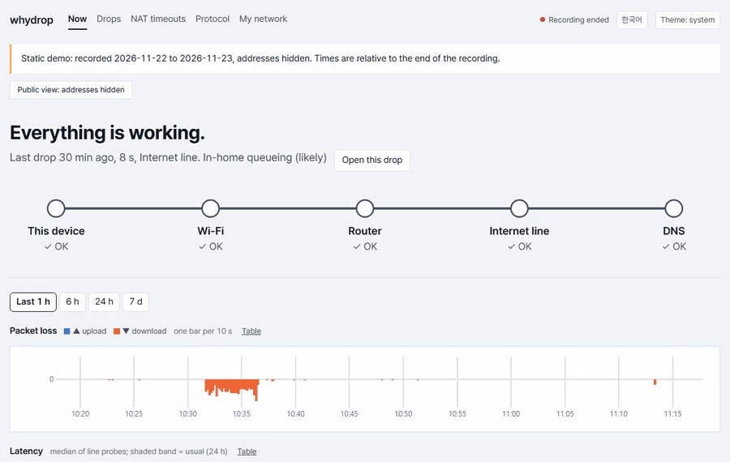

**English** | [한국어](https://github.com/YHK0427/whydrop/blob/main/README.ko.md)

# Is it your Wi-Fi, your router, or your ISP — and what happened to the packets?

[](https://github.com/YHK0427/whydrop/actions/workflows/ci.yml)  

whydrop is a self-hosted black box for a home connection. It probes every second over TCP and UDP, so it is built to catch even 3-second drops, and for each drop it tells you **where** on the path it broke, the **likely cause**, and what TCP and UDP did meanwhile.

[](https://yhk0427.github.io/whydrop/)

Three verdicts, worded as its alerts word them (durations made up):

> **Internet line dropped for 46 s. Line drop in the ISP segment (likely).** *Save the evidence with export and contact your ISP.*
>
> **Wi-Fi dropped for 4 s. Wi-Fi problem (likely).** *If the signal was weak, move the AP or change channel. If the AP vanished, check its power or reboot it.*
>
> **NAT/firewall state expired (likely).** *The idle interval is longer than the measured NAT timeout: set keepalive below it.*

The drop's page adds the evidence: which direction lost the packets, what the router did meanwhile, what TCP did.

**[Live demo](https://yhk0427.github.io/whydrop/)**: the dashboard's public view over two days of real recordings, with faults injected on purpose (read-only, times relative to the recording).

## Quick start

```sh
git clone https://github.com/YHK0427/whydrop && cd whydrop
docker compose up -d
docker compose logs whydrop | grep dashboard     # open the link it prints (it carries a token)
docker compose exec whydrop cat /data/ui-token   # the token again later (it is logged only when generated)
```

That's basic mode: no account, no server, nothing to configure. Run it on a machine that stays on and uses the connection you care about (a home server, a Raspberry Pi, a NAS with Docker). For upload/download separation and TCP connection insight, add [precision mode](#precision-mode).

## What it tells you

- **Where it broke**, hop by hop: *this device → Wi-Fi or cable → router → internet line → DNS*. The dashboard draws that path as a cable that visibly breaks at the failing hop.
- **The likely cause**, from rules you can read in [docs/design](https://github.com/YHK0427/whydrop/blob/main/docs/design.md): Wi-Fi problem, wired link, the host's own network config, router, public IP change, NAT state lost or reset, DNS (router, ISP, public resolvers blocked, or all of them), a line drop in the ISP segment, a lossy line, or queueing. Every verdict says *likely*: whydrop infers, it doesn't know.
- **What to do next**, in one sentence per cause.
- **Rough patches** that aren't outages: packet loss, high latency from queueing, weak Wi-Fi signal, loss between Wi-Fi and the router.
- **Evidence you can hand over**: a plain-text summary for a support chat, CSV/JSON exports, a card image, and a public-view bug report with addresses removed.

How the decisions are made — quorum across independent providers, a gate so random loss isn't called an outage, an 80-second settle before a cause is final — is in [docs/how-it-works](https://github.com/YHK0427/whydrop/blob/main/docs/how-it-works.md).

## Precision mode

Basic mode can only see "a reply came back or it didn't". With a **reflector** — a tiny whydrop process on any cheap VPS (a free tier is enough) — the agent adds:

- **udp_stream**: 10 UDP packets a second with sequence numbers. The reflector reports what it received, so each lost packet is placed **upload or download**.
- **A hot TCP connection** with a heartbeat every second. During a drop you see what TCP itself did: stalls, retransmissions with the RTO doubling, resets, reconnects (from the kernel's `TCP_INFO` on Linux).
- **An idle TCP connection** that stays silent for minutes, to catch a NAT or firewall that silently forgets connections.

Both ends share a secret (`WHYDROP_SECRET`); every packet carries an HMAC, and the reflector never answers anything it can't verify. Setup: [docs/deploy-reflector](https://github.com/YHK0427/whydrop/blob/main/docs/deploy-reflector.md). Wire format: [docs/protocol](https://github.com/YHK0427/whydrop/blob/main/docs/protocol.md).

## nat-test

```sh
docker compose exec whydrop whydrop nat-test
```

Measures how long the NAT and firewalls on your path keep an idle UDP mapping (10 s – 10 min) and an idle TCP connection (1 min – 1 h), all delays in parallel, and recommends a keepalive: for example *"timeout between 90 s and 120 s; keepalive 70 s or less"* (a real home router). Needs precision mode.

Options: `--udp-only`, `--tcp-only`, `--max-delay N` (skip delays over N seconds), `--enable-7500` (also try 7500 s TCP, just over the 2 h 4 min that RFC 5382 sets as the minimum; the reflector must be started with `--enable-7500` too). `[nat] enable_7500 = true` in `whydrop.toml` does the same for this command and for the dashboard's NAT test button.

## Configuration

Everything is optional. Settings come from `WHYDROP_*` environment variables (in `.env` next to `compose.yaml`), then `whydrop.toml`, then defaults. [`whydrop.example.toml`](https://github.com/YHK0427/whydrop/blob/main/whydrop.example.toml) documents every key; [`.env.example`](https://github.com/YHK0427/whydrop/blob/main/.env.example) the environment. Alerts and most tuning live only in `whydrop.toml`: with Docker, put it next to `compose.yaml` and add `- ./whydrop.toml:/app/whydrop.toml:ro` under `volumes:`.

| Variable | What it does |
|---|---|
| `WHYDROP_REFLECTOR` | `host` or `host:port` of your reflector (turns on precision mode) |
| `WHYDROP_SECRET` | shared secret, ≥ 32 bytes; environment only, never in a file in the repo |
| `WHYDROP_WEB_BIND` | dashboard address; the compose default is `0.0.0.0:8790`, use `127.0.0.1:8790` to keep it local |
| `WHYDROP_UI_TOKEN` | your own dashboard token (otherwise one is generated and logged once) |
| `WHYDROP_AGENT_NAME` | this agent's name in the dashboard header and alert titles (default `home`) |

## Reading the dashboard

- **Now**: one sentence ("Everything is working." / "Internet line is down right now (32 s so far)."), the path diagram, your last drop, and three lanes on one time axis — packet loss (upload above the line, download below), latency with the usual range shaded, and the TCP connection's state.
- **Drops**: every drop; open one for its timeline, the per-packet strip (10 squares a second), *In protocol terms* (sequence numbers, retransmissions, RST or not), evidence and exports.
- **NAT timeouts**, **Protocol** (live packets as hex with every field named), **My network** (the mode, which targets were excluded and why, findings, availability this month).
- English and Korean, light and dark, phone-sized screens. **Start a 2-minute test** opens a 2-minute window labelled as your test, so you can prove it works before a real drop happens.

The dashboard needs a token when it listens beyond localhost. `?public=1` switches any page to the public view: addresses hidden, times relative — the same view the bug reports and alerts use.

## Alerts and export

- Webhooks (`notify.webhook_url`, format `json`, `ntfy` or `discord`) fire **when a drop is finalized**, 80 s after it ends (120 s when Wi-Fi, the cable or the router was down) — nothing can be sent through a dead line anyway. Failed deliveries are retried for 24 h (up to 100 waiting). At most 12 alerts an hour: when a flapping line finalizes more, the next alert says how many were held. Bodies use the public view; `notify.lang = "ko"` sends them in the dashboard's Korean, and titles name the agent (`agent_name`).
- Optional Uptime Kuma push heartbeat (`notify.kuma_push_url`).
- Exports: drops, rough patches, events and minute aggregates as CSV or JSON; a per-drop bug report (public view, ±10 min); `whydrop replay` re-runs the analysis over a recorded database (`--write` updates past verdicts after an upgrade, with a backup first); `whydrop export-static` writes a read-only public demo of the dashboard.

## Tools that work alongside

Checked 2026-11-17 (isitmyisp again on 2026-11-20); these change fast, so check them yourself.

| Tool | Good at | How whydrop differs |
|---|---|---|
| [isitmyisp](https://github.com/21Enzo17/isitmyisp) | Same question ("Is it your Wi-Fi, your router or your ISP?"); verdicts, ISP reports, CGNAT/double-NAT checks, PDF reports, Prometheus | Its documented incident rules use 30 s windows, so a single few-second drop opens no incident (read from its docs, not tested). whydrop probes every second, splits upload/download, measures NAT timeouts and tracks Wi-Fi re-associations |
| [Uptime Kuma](https://github.com/louislam/uptime-kuma) | Is a service up; great notifications | It monitors services, not the path; whydrop can push its heartbeat to Kuma |
| SmokePing / blackbox_exporter | Long-term latency and loss graphs | Interpretation is left to you; whydrop correlates TCP, UDP, DNS and Wi-Fi into a verdict |
| [irtt](https://github.com/heistp/irtt) | Precise one-off UDP RTT and up/down loss | A CLI for a test run; whydrop records continuously with causes and a dashboard |

## Privacy

Everything stays on your machine. whydrop never collects your Wi-Fi name; access-point identifiers are stored only as a salted hash with a local nickname. Logs mask your router's and ISP resolver's addresses. The public view — used by `?public=1`, alerts, bug reports and the static demo — hides your public IP, ports, ISP DNS, reflector address, hostnames and interface names, shows internal addresses as `x.x.x.N`, and makes times relative.

## FAQ

**Why no ICMP ping?** It needs privileges in a container and many networks rate-limit or drop it, which looks like loss that isn't there. whydrop uses UDP (STUN, DNS, its own reflector) and TCP. The one exception is the router check on Windows, where an unprivileged ICMP echo is the reliable way to tell the router is alive.

**Why Python, and how heavy is it?** Standard library only for the agent, the probes and the reflector (the dashboard adds FastAPI). Measured on a home server: about 19 MiB of memory for recording, about 39 MiB with the dashboard, about 2 % of one core. Traffic: about 6.5 kbit/s in basic mode (measured), about 18.5 kbit/s in precision mode (computed from measured packet sizes; the test suite keeps both under their budgets of 8 and 20 kbit/s).

**Does precision mode need a paid VPS?** No. The reflector needs a public IP and one open port (UDP and TCP 48100); a free-tier VM is enough.

**IPv6?** v0.1 measures IPv4. Dual-stack networks work; the IPv6 path isn't judged separately yet.

**Docker Desktop, WSL or a VM?** whydrop refuses to start in a VM-backed Docker (Docker Desktop on Windows/macOS, WSL): it would be measuring the VM's virtual network, not yours. Use Linux with `network_mode: host`, or run it natively.

**Mesh Wi-Fi?** Roaming between nodes is recorded as a roam, not a drop; a roam with loss becomes a small point event.

**Unraid / Synology?** It should work anywhere Linux containers can use host networking, but it hasn't been tried on those systems yet; reports are welcome.

## Compatibility

| Where | Basic mode | Precision mode | Wi-Fi details |
|---|---|---|---|
| Linux (Docker, host network) | ✓ | ✓ | ✓ (`iw`) |
| Linux (from source: `pip install '.[web]'`) | ✓ | ✓ | ✓ |
| Windows (native, from source) | ✓ | ✓ (no `TCP_INFO`) | ✓ (`netsh`, English or Korean; other languages: associated or not, and which AP) |
| Docker Desktop / WSL | refused on purpose | — | — |
| Raspberry Pi and other arm64 / armv7 | images are built and smoke-tested under emulation on release; not yet tried on hardware | | |

"✓" means it runs in CI or was run on a real machine (a Linux home server on Wi-Fi, a Windows laptop). Precision mode is tested end to end against a real reflector process over loopback, with injected loss, stalls and resets; a run against a reflector across the internet is still to come.

## How this was built

whydrop was written with an AI agent (Claude) under a human's direction: test-first, with independent AI reviewers before every merge and real measurements on a real network. What the agent did, what the human decided, and what the reviews caught is logged in [docs/ai-process](https://github.com/YHK0427/whydrop/blob/main/docs/ai-process.md).

## License

MIT. Bundled: uPlot (MIT), Pretendard (SIL OFL 1.1).
