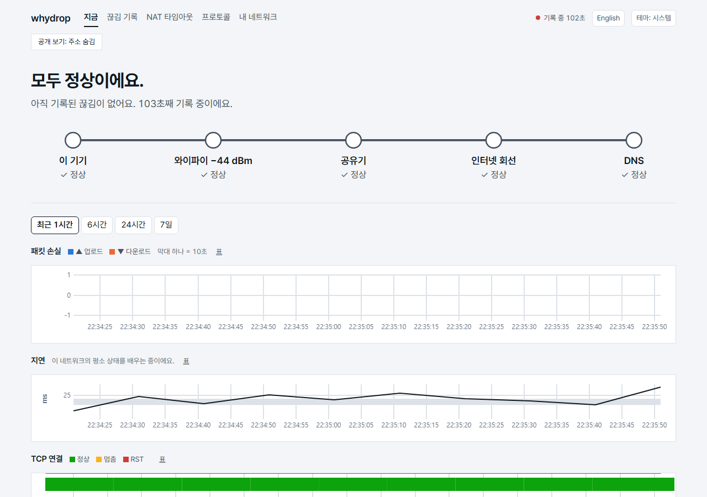
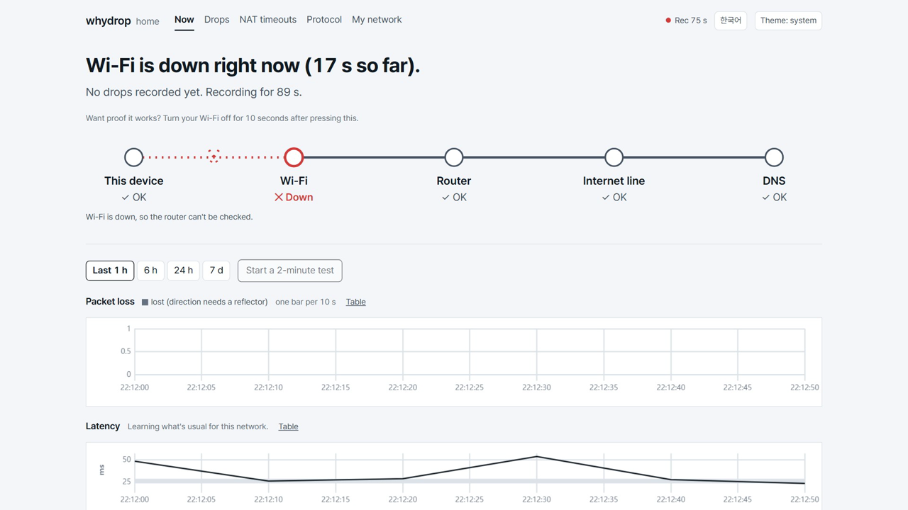
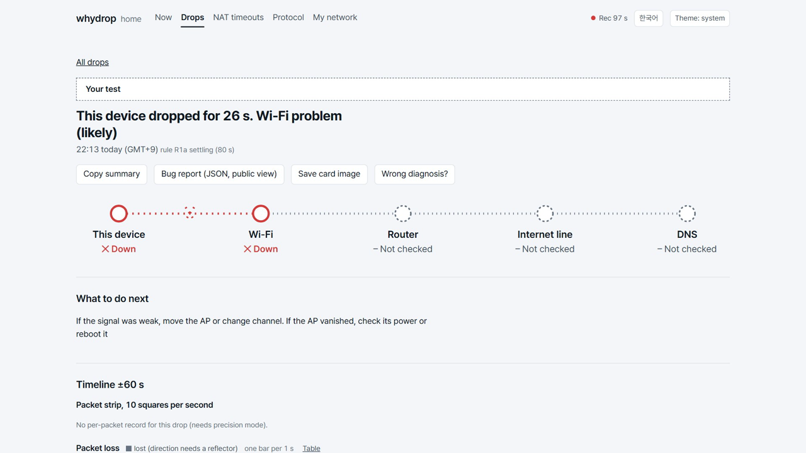
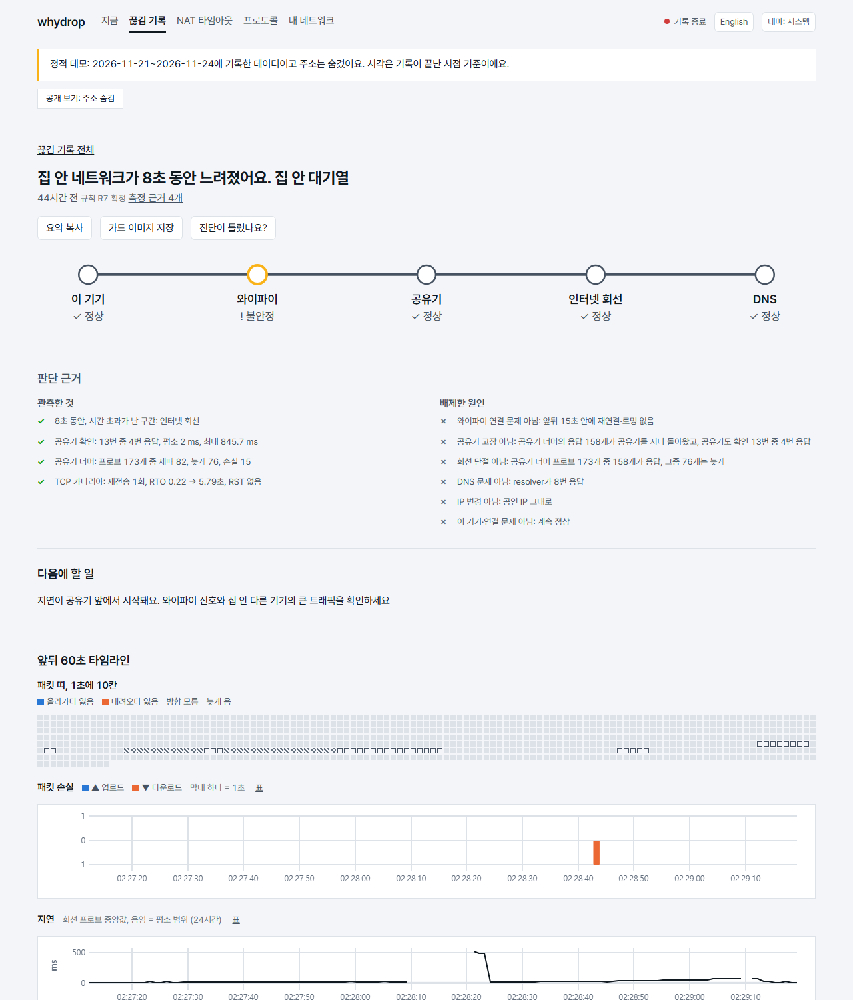
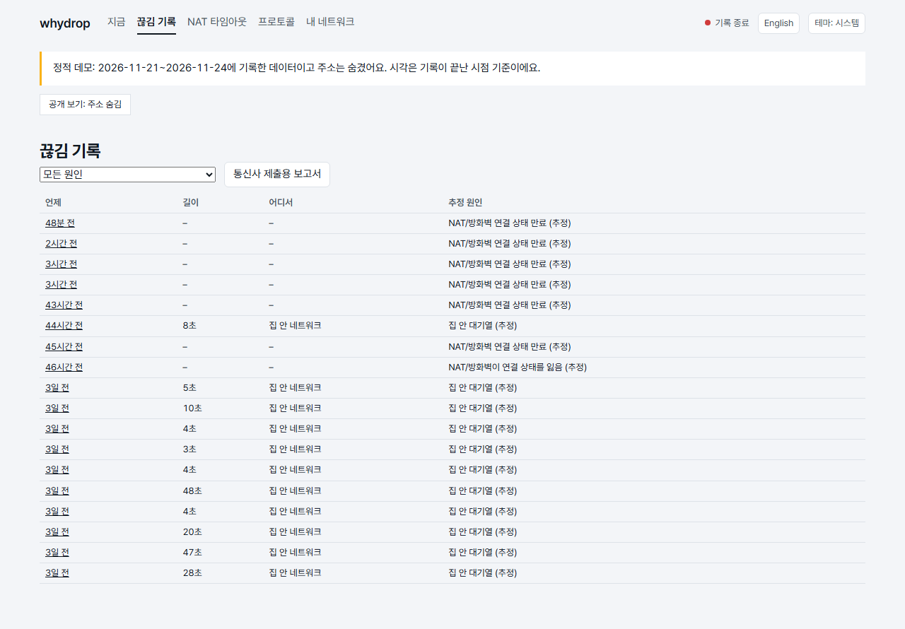
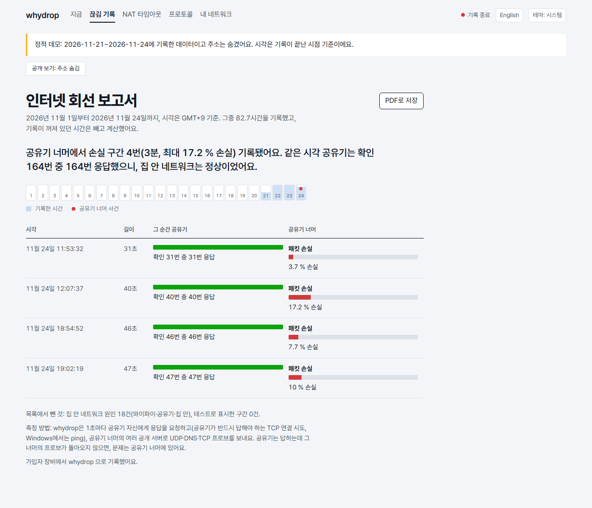
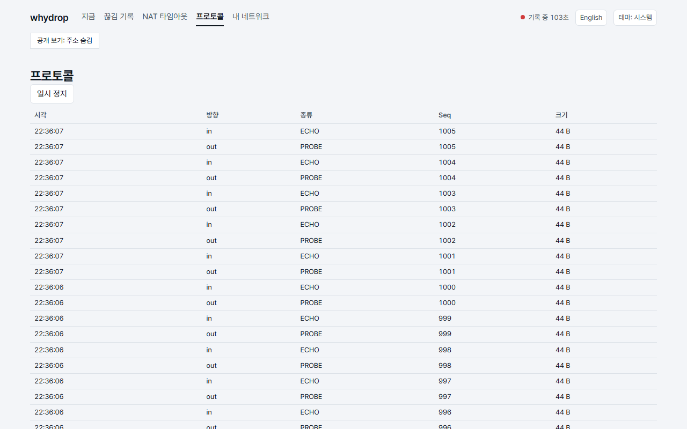
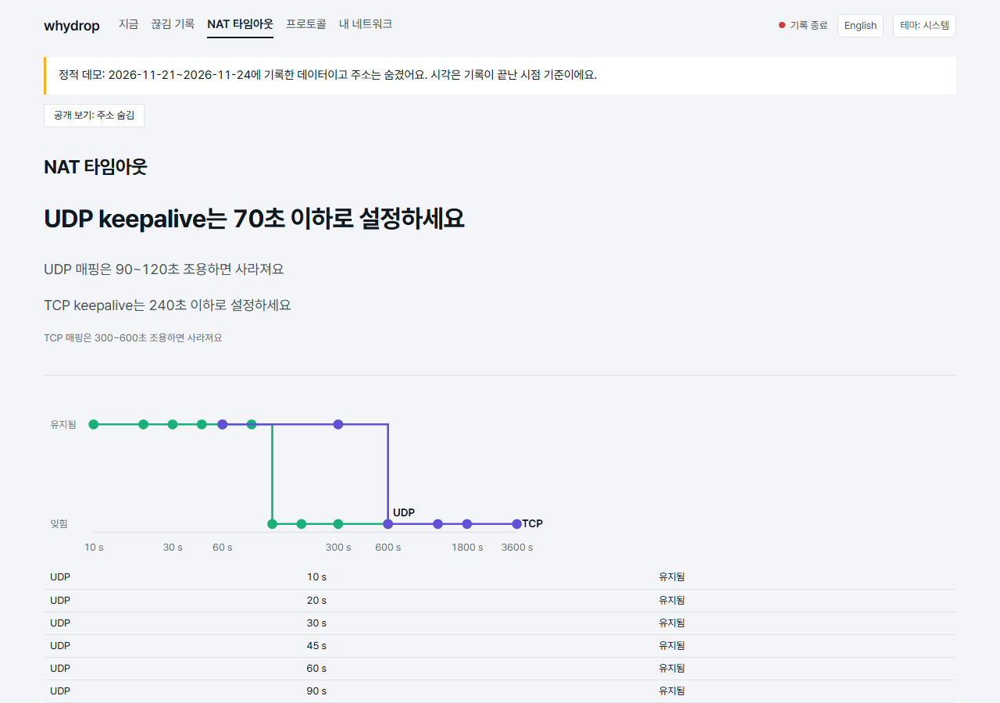
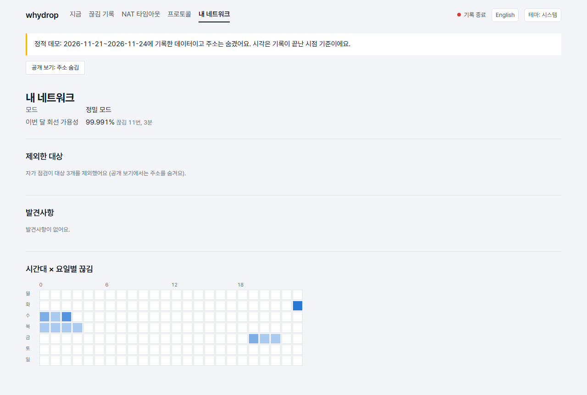

# whydrop 사용법, 단계별로

[English](usage.md)

이 문서는 whydrop을 내 컴퓨터에서 처음부터 끝까지 써 보는 순서예요. 설치하고, 대시보드를 보고, 일부러 끊김을 만들고, 판정을 읽고, 마지막에 정밀 모드를 켜서 TCP와 UDP 프로토콜이 실제로 오가는 걸 확인해요. 스크린샷은 모두 실제 기록이에요. 노트북 화면은 2026-11-27 Windows 11 노트북에서, 나머지는 [공개 데모](https://yhk0427.github.io/whydrop/)(홈서버 3일 기록, 주소 가림)에서 찍었어요.

1. [준비물](#1-준비물)
2. [설치하고 실행하기](#2-설치하고-실행하기)
3. [대시보드 첫 1분](#3-대시보드-첫-1분)
4. [일부러 끊김 만들기](#4-일부러-끊김-만들기)
5. [끊김 하나 읽기](#5-끊김-하나-읽기)
6. [끊김 기록과 통신사 제출용 보고서](#6-끊김-기록과-통신사-제출용-보고서)
7. [정밀 모드: TCP/UDP 프로토콜 보기](#7-정밀-모드-tcpudp-프로토콜-보기)
8. [NAT 타임아웃](#8-nat-타임아웃)
9. [내 네트워크](#9-내-네트워크)
10. [알림, 내보내기, 그 밖의 명령](#10-알림-내보내기-그-밖의-명령)
11. [멈추기, 데이터 위치, 지우기](#11-멈추기-데이터-위치-지우기)
12. [문제가 생기면](#12-문제가-생기면)

## 1. 준비물

- **기본 모드**(2~6장, 9장): 확인하고 싶은 인터넷에 연결된 컴퓨터 한 대, Git, Python 3.11~3.14. 그 밖엔 필요 없어요. 계정도, 서버도, 설정도요.
- **정밀 모드**(7~8장): 여기에 **reflector**가 더 필요해요. agent와 자체 UDP·TCP 프로토콜로 주고받는 작은 whydrop 프로세스예요. 내 회선을 *재려면* 인터넷 건너편(저렴한 VPS, 무료 등급이면 충분)에 있어야 하고, *프로토콜이 도는 걸 보기만* 하려면 같은 노트북에서 띄워도 돼요(7.2절).

Windows(직접 설치)와 Linux에서 확인했어요. macOS에서는 아직 돌려 보지 않았어요. Docker는 늘 켜진 Linux 서버용이에요. Windows/macOS의 Docker Desktop과 WSL에서는 일부러 시작하지 않아요. 내 네트워크가 아니라 VM의 가상 네트워크를 재게 되니까요.

## 2. 설치하고 실행하기

**Windows** (PowerShell):

```powershell
git clone https://github.com/YHK0427/whydrop; cd whydrop
py -m venv .venv
.venv\Scripts\pip install ".[web]"
.venv\Scripts\whydrop agent
```

**Linux**:

```sh
git clone https://github.com/YHK0427/whydrop && cd whydrop
python3 -m venv .venv && .venv/bin/pip install '.[web]'
.venv/bin/whydrop agent
```

`.[web]`은 대시보드(FastAPI, uvicorn)를 같이 설치해요. agent, 프로브, reflector 자체는 Python 표준 라이브러리만 써요.

몇 초 뒤 터미널에 세 줄이 나와요.

```
INFO whydrop.agent self-check ok; excluded: none
INFO whydrop.agent watching: mode=basic link=wifi gateway=x.x.x.1 isp_dns=unknown excluded=none
INFO whydrop.agent dashboard: http://127.0.0.1:8790/
```

- **self-check**: 기록을 시작하기 전에, 앞으로 쓸 대상(공유기, 공개 STUN·DNS 서버, 큰 사이트 몇 곳으로의 TCP)이 내 네트워크에서 실제로 응답하는지 확인해요. 끝내 응답하지 않는 대상은 계속 "손실"로 세지 않고 *제외*해요.
- **watching**: 모드(`basic` 또는 `precision`), 연결 방식(`wifi` 또는 `wired`), 공유기(로그에서는 주소를 가려요), 찾았다면 통신사 DNS.
- **dashboard**: 같은 컴퓨터의 브라우저로 이 주소를 여세요. 이 컴퓨터에서는 토큰이 필요 없어요. 대시보드를 다른 기기에서도 열 수 있게 할 때(`WHYDROP_WEB_BIND`)만 토큰이 필요해요.

터미널은 열어 두세요. 닫으면 기록이 멈춰요.

whydrop이 원래 사는 곳인 **늘 켜진 Linux 서버**에서는 Docker로 돌리세요. README의 [빠른 시작](../README.ko.md#빠른-시작)에 있어요.

## 3. 대시보드 첫 1분

<http://127.0.0.1:8790/>을 열면 **지금** 페이지가 나와요.



위에서부터:

1. **지금 상태 한 문장.** 처음 30초쯤은 self-check 중이라 "네트워크를 확인하고 있어요…"라고 나오고, 그다음 "모두 정상이에요." 또는 끊긴 동안 "지금 와이파이가 끊겨 있어요 (17초째)." 같은 문장이 나와요.
2. **경로.** 내 컴퓨터에서 바깥으로 다섯 구간이에요. 구간마다 자기 프로브로 판단해요.

   | 구간 | 보는 것 |
   |---|---|
   | 이 기기 | 컴퓨터에 아직 주소와 경로(route)가 있는지 |
   | 와이파이(또는 유선) | 연결 상태와 신호(Windows는 `netsh`, Linux는 `iw`). 표시된 dBm이 지금 신호 세기예요 |
   | 공유기 | 공유기가 1초마다 확인에 응답하는지 |
   | 인터넷 회선 | 공유기를 *거쳐* 서로 다른 여러 곳(STUN, DNS, TCP 연결, 정밀 모드면 reflector까지)으로 가는 프로브 |
   | DNS | 공유기, 통신사, 공개 DNS를 통한 이름 조회 |

   끊긴 구간은 빨갛게 바뀌고 선이 거기서 끊어져요. 구간을 누르면 그 구간의 지난 끊김만 모아 보여 줘요.
3. **최근 1시간 / 6시간 / 24시간 / 7일**은 아래 차트의 범위예요. **2분 테스트 시작**은 4장에서 써요.
4. **패킷 손실**: 막대 하나에 잃은 프로브 수. 기본 모드에서는 방향을 모르고, 정밀 모드에서는 업로드는 선 위(파랑 ▲), 다운로드는 선 아래(주황 ▼)로 그려요.
5. **지연**: 회선 프로브의 중앙값이에요. 1시간이 지나면 이 네트워크의 평소 범위(24시간 10번째 백분위)가 회색 띠로 나오고, 그 전에는 "이 네트워크의 평소 상태를 배우는 중이에요."라고 나와요.
6. **TCP 연결**(정밀 모드): reflector와 열어 둔 TCP 연결의 1초 단위 상태예요. 정상, 멈춤(stall), RST.
7. **최근 끊김**과 **불안정 구간**(끊기진 않았지만 손실이나 지연이 컸던 시간).

**표** 링크는 같은 숫자를 표로 보여 줘요(화면 낭독기나 복사용). **English**는 대시보드 전체를 영어로 바꾸고, **테마**는 밝게·어둡게·시스템을 돌아가며 바꿔요.

## 4. 일부러 끊김 만들기

인터넷이 실제로 끊길 때까지 기다리지 않아도 돼요.

1. **지금** 페이지에서 **2분 테스트 시작**을 눌러요. 앞으로 2분은 "내 테스트"로 표시돼서 진짜 끊김과 섞이지 않고, 통신사 보고서에도 들어가지 않아요.
2. 와이파이를 끄고 10초쯤 기다렸다가 다시 켜요. (유선이면 케이블을 뽑았다 꽂아요.)
3. 페이지를 지켜보세요. 새로고침할 필요 없어요.



**약 15초 늦게 나타나는 이유.** whydrop은 1초 단위 판단을 실제보다 약 14초 늦게 해요. 일부러요. 늦게라도 돌아온 응답은 길이 살아 있었다는 증거라서, 늦은 응답을 다 기다린 뒤에야 "잃었다"고 판단해요. 그래서 느렸을 뿐인 순간을 끊김으로 잘못 기록하지 않아요. 제목의 초는 실제 시작부터 세요("17초째").

와이파이가 돌아오면 **최근 끊김**에 길이, 끊긴 구간, 추정 원인, "내 테스트" 표시와 함께 나타나요.

## 5. 끊김 하나 읽기

끊김을 누르세요(**지금** 또는 **끊김 기록**에서). 4장의 노트북 테스트예요.



공개 데모의 실제 끊김도 하나 볼게요. 정밀 모드에서 8초 동안 느려진 경우예요.



페이지에 있는 것:

- **제목**: 어느 구간이, 얼마나, 추정 원인은 무엇인지. 예: "집 네트워크가 8초 느려졌어요. 집 안 대기열". 아래에 판단한 규칙(R1a, R7 등, 전체 규칙은 [설계 문서](design.ko.md))과 상태가 나와요. 늦게 오는 증거로 바뀔 수 있는 동안은 *확정 중 (80초)*, 그다음 *확정*.
- **요약 복사**: 채팅이나 문의에 붙일 짧은 글. **버그 리포트 (JSON, 공개 보기)**: 앞뒤 10분의 기록 전부, 주소는 가린 채로, 이슈에 첨부용. **카드 이미지 저장**: 공유용 1200×630 이미지(공개 보기 문구). **진단이 틀렸나요?**: 내용이 채워진 GitHub 이슈 작성 화면을 열어요.
- **경로**: 끊긴 순간의 상태. 끊긴 구간 너머는 닿을 수 없으니 "확인 안 함"으로 나와요.
- **판단 근거**: **관측한 것**에는 판정이 기대는 사실(길이, 공유기 응답과 RTT, 공유기 너머 프로브 중 제때·늦게·아예 안 온 수, TCP 재전송과 RST)이, **배제한 원인**에는 다른 원인마다 그걸 배제한 측정값이 나와요.
- **다음에 할 일**: 이 원인에 맞는 한 문장.
- **앞뒤 60초 타임라인**:
  - **패킷 띠, 1초에 10칸**(정밀 모드): UDP 스트림의 패킷 하나가 한 칸이에요. 범례로 올라가다 잃음(파랑), 내려오다 잃음(주황), 방향 모름, 늦게 옴을 구분해요.
  - **패킷 손실**과 **지연**, 1초에 막대 하나.
  - **TCP 연결**: TCP가 실제로 한 일(멈춤, 타임아웃이 두 배씩 늘어나는 재전송, RST 여부).
- **프로토콜로 보면**(정밀 모드): 같은 끊김을 시퀀스 번호, RTO, RST로 다시 설명해요.
- **근거**, **확정 원인 이력**(확정 중에 원인이 바뀌었다면), **주석**(내 테스트, 또는 직접 표시한 구간).

## 6. 끊김 기록과 통신사 제출용 보고서

**끊김 기록**은 범위 안의 끊김을 최신순으로 보여 줘요. 언제, 얼마나, 어디서, 추정 원인. 원인은 메뉴로, 구간은 경로에서 눌러서 거를 수 있어요.



**통신사 제출용 보고서**는 이번 달 중 공유기 *너머*에서 생긴 일(회선 끊김, 느려짐, 손실 구간, 공인 IP 변경, 통신사 DNS 실패)만 담은 인쇄용 페이지를 열어요. 일마다 같은 순간의 공유기 응답을 나란히 놓아서 "공유기 재부팅해 보세요"에 대한 답이 이미 들어 있어요. 집 안 문제와 내 테스트 구간은 개수만 세고 목록에는 넣지 않아요. **PDF로 저장**은 A4로 인쇄하고, **텍스트로 받기**는 일반 텍스트로 줘요.



## 7. 정밀 모드: TCP/UDP 프로토콜 보기

### 7.1 더해지는 것

기본 모드는 "응답이 왔다/안 왔다"만 알아요. reflector가 있으면 agent가 자체 프로토콜로 세 가지 흐름을 더 만들어요(바이트 단위 구조는 [프로토콜 문서](protocol.ko.md)).

| 흐름 | 전송 | 보여 주는 것 |
|---|---|---|
| **udp_stream** | UDP, 1초에 10개, 패킷마다 시퀀스 번호 | reflector가 받은 시퀀스 번호를 알려 주므로, 잃은 패킷마다 **올라가다**(reflector가 못 받음) 잃었는지 **내려오다**(받았는데 응답이 사라짐) 잃었는지 갈라요 |
| **뜨거운 TCP 연결** | TCP, 1초마다 하트비트 | 끊긴 동안 TCP가 한 일: 멈춤, RTO가 두 배씩 늘어나는 재전송, RST, 재연결 |
| **유휴 TCP 카나리** | TCP, 몇 분씩 조용히 | 중간의 NAT나 방화벽이 조용한 연결을 몰래 잊는지 |

양쪽은 비밀값(`WHYDROP_SECRET`, 32바이트 이상)을 나눠 가져요. 모든 패킷에 HMAC이 붙고, reflector는 검증되지 않는 패킷에는 절대 응답하지 않아요.

### 7.2 노트북 한 대로 해 보기 (프로토콜 확인용)

reflector와 agent를 같은 컴퓨터에서 띄우는 방법이에요. **패킷이 컴퓨터 밖으로 나가지 않아요**(127.0.0.1로만 오가요). 그래서 내 네트워크에 대해서는 아무것도 재지 않아요. 와이파이를 꺼도 이 패킷들은 실패하지 않아요. 대신 프로토콜 자체가 도는 걸 볼 수 있어요. 시퀀스 번호가 붙은 UDP 스트림, TCP 하트비트, HMAC, 대시보드의 정밀 모드 화면이요.

먼저 기본 모드 agent를 멈추세요(그 터미널에서 Ctrl+C). 그다음 `whydrop` 폴더에서:

**터미널 1 — reflector** (Windows PowerShell):

```powershell
.venv\Scripts\python -c "import secrets; print(secrets.token_hex(32))" > $env:TEMP\whydrop-secret
$env:WHYDROP_SECRET = Get-Content $env:TEMP\whydrop-secret
.venv\Scripts\whydrop reflector --host 127.0.0.1
```

`whydrop reflector … listening udp :48100 tcp :48100`이 나와요.

**터미널 2 — 정밀 모드 agent**:

```powershell
$env:WHYDROP_SECRET = Get-Content $env:TEMP\whydrop-secret
$env:WHYDROP_REFLECTOR = "127.0.0.1"
.venv\Scripts\whydrop agent
```

Linux에서는 `export WHYDROP_SECRET=$(cat /tmp/whydrop-secret)`처럼 바꾸고 `.venv/bin/whydrop`을 쓰면 돼요.

이제 agent가 `mode=precision`을 출력해요. **지금** 페이지의 패킷 손실에 업로드/다운로드 범례가 생기고 **TCP 연결** 칸이 초록으로 채워져요(3장 스크린샷이 이 상태예요). **프로토콜**을 여세요.



한 줄이 패킷 하나예요. **PROBE**가 나가고 같은 시퀀스 번호의 **ECHO**가 돌아와요. 크기는 둘 다 44바이트(본문 36바이트 + HMAC 8바이트)예요. 줄을 누르면 [프로토콜 문서](protocol.ko.md)의 필드 이름이 붙은 16진수 바이트가 나와요. **일시 정지**는 목록을 멈춰요. 같은 패킷을 Wireshark로 보려면 [contrib/wireshark](../contrib/wireshark)의 분석기를 넣고 루프백 어댑터에서 포트 48100을 캡처하세요.

### 7.3 내 회선을 진짜로 재려면

reflector를 인터넷 건너편 컴퓨터에서 돌리세요. VPS에 올리는 방법은 [reflector 배포](deploy-reflector.ko.md)에 있어요(Docker 또는 Python, 포트 하나 UDP·TCP 48100). 그다음 agent를 같은 비밀값과 `WHYDROP_REFLECTOR=<그 호스트>`로 시작하면 돼요. 이제 회선이 끊기면 패킷을 어느 방향에서 잃었는지 나오고, 5장의 패킷 띠도 채워져요.

## 8. NAT 타임아웃

공유기와 방화벽은 너무 오래 조용한 연결을 잊어버려요. 그러면 연결을 열어 두는 앱(게임, 인터넷 전화, VPN, 메신저)이 예고 없이 끊겨요. **NAT 타임아웃** 페이지는 내 경로가 조용한 UDP 매핑(10초~10분)과 조용한 TCP 연결(1분~1시간)을 얼마나 기억하는지 재고, keepalive 값을 추천해요.



**NAT 테스트 실행**을 누르세요(agent가 도는 동안 터미널에서 `whydrop nat-test`도 돼요. `--udp-only`, `--tcp-only`, `--max-delay N`). 모든 지연을 동시에 재서 전체 시간은 가장 긴 지연만큼 걸려요. 정밀 모드에서, reflector가 **NAT 건너편**에 있어야 해요. 노트북 한 대(7.2절)에서는 사이에 NAT가 없어서 모든 지연이 그냥 살아남아요.

## 9. 내 네트워크



- **모드**: 기본 또는 정밀.
- **이번 달 회선 가용성**: 공유기 너머 회선이 살아 있던 시간 비율, 끊김 수와 총 길이.
- **제외한 대상**: self-check가 빼 둔 대상과 이유(예: 내 네트워크가 막는 DNS 서버).
- **발견사항**: 오래 가는 관찰. 예를 들어 프로브가 VPN으로 나가고 있다거나, reflector가 비밀값을 거부한다거나.
- **시간대 × 요일별 끊김**: 끊김이 주로 언제 생기는지.

## 10. 알림, 내보내기, 그 밖의 명령

**알림.** agent를 시작하는 폴더에 `whydrop.toml`을 만드세요(모든 키는 [`whydrop.example.toml`](../whydrop.example.toml)에 설명돼 있어요).

```toml
[notify]
webhook_url = "https://ntfy.sh/your-topic"
format = "ntfy"        # 또는 "json", "discord"
lang = "ko"            # 또는 "en"
```

알림은 끊김이 확정될 때 가요(끝나고 80초 뒤, 와이파이·케이블·공유기가 끊겼던 경우는 130초 뒤. 끊긴 회선으로는 어차피 보낼 수 없으니까요). 한 시간에 최대 12개, 주소는 가려서 보내요.

**내보내기** (agent가 도는 동안 브라우저로 열어요):

- `http://127.0.0.1:8790/api/export/incidents.csv` — 끊김 목록(`conditions`, `events`, `samples_1m`도 돼요. `.csv` 대신 `.json`도 돼요)
- `http://127.0.0.1:8790/api/isp-report?format=json` — 통신사 보고서의 숫자
- `http://127.0.0.1:8790/api/metrics` — Prometheus 지표. Grafana와 Home Assistant 설정은 [연동 문서](integrations.ko.md)에 있어요

**그 밖의 명령:**

| 명령 | 하는 일 |
|---|---|
| `whydrop annotate --label user-test --start 2026-11-27T22:12:00+09:00 --end …` | 구간에 이름 붙이기(`reproduced`, `injected`, `user-test`). 그 구간의 끊김에 표시가 붙어요 |
| `whydrop replay whydrop-data/whydrop.db` | 기록 위에서 분석을 다시 돌려요. `--write`는 업그레이드 뒤 지난 판정을 고쳐 써요(먼저 백업) |
| `whydrop export-static whydrop-data/whydrop.db --out site` | 데모처럼 읽기 전용 공개 대시보드를 만들어요 |
| `whydrop --version` | 설치된 버전 |

## 11. 멈추기, 데이터 위치, 지우기

- **멈추기**: agent 터미널에서 Ctrl+C(또는 터미널 닫기).
- **데이터**: 실행한 폴더의 `whydrop-data/whydrop.db`(SQLite)에 전부 있어요. 1초 단위 데이터는 7일(끊김 앞뒤 10분은 90일), 1분 단위는 1년 보관해요. 알림을 설정하지 않으면 어디로도 보내지 않아요.
- **지우기**: `whydrop` 폴더를 지우면 끝이에요.

## 12. 문제가 생기면

| 보이는 것 | 할 일 |
|---|---|
| `whydrop refuses to start in a VM-backed Docker` | Docker Desktop이나 WSL에서 돌린 거예요. 2장 방법으로 하세요 |
| pip가 `requires a different Python` | Python 3.11~3.14를 쓰세요. 예: `py -3.13 -m venv .venv` |
| `dashboard off: can't listen on 127.0.0.1:8790` | 다른 프로그램이 포트를 쓰고 있어요. `$env:WHYDROP_WEB_BIND = "127.0.0.1:8791"`(Linux는 `export …`)로 바꾸고 다시 시작하세요 |
| 대시보드가 토큰을 물어봐요 | 127.0.0.1이 아니라 네트워크 주소로 연 경우예요. 토큰은 `whydrop-data/ui-token`에 있어요 |
| "네트워크를 확인하고 있어요…"가 한동안 계속돼요 | self-check는 최대 30초쯤 걸리고, 네트워크가 바뀌면 다시 돌아요 |
| 끊김이 시작되고 15초쯤 뒤에 나타나요 | 정상이에요. 4장을 보세요 |
| 다른 언어 Windows에서 와이파이 세부 정보가 없어요 | 신호와 AP는 영어·한국어 `netsh`에서 읽어요. 다른 언어에서도 연결/끊김은 나와요 |

더 깊은 내용: [작동 방식](how-it-works.ko.md), [설계](design.ko.md)(모든 규칙과 기준값), [프로토콜](protocol.ko.md).
