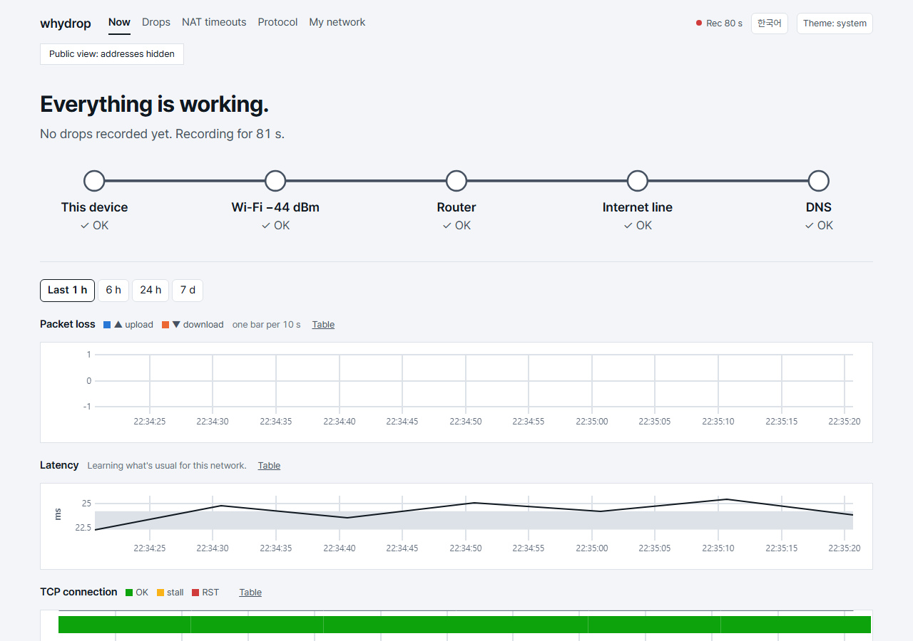
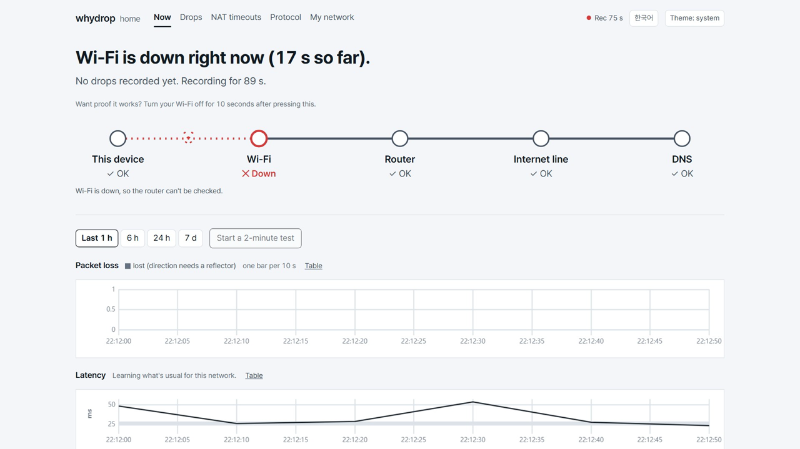
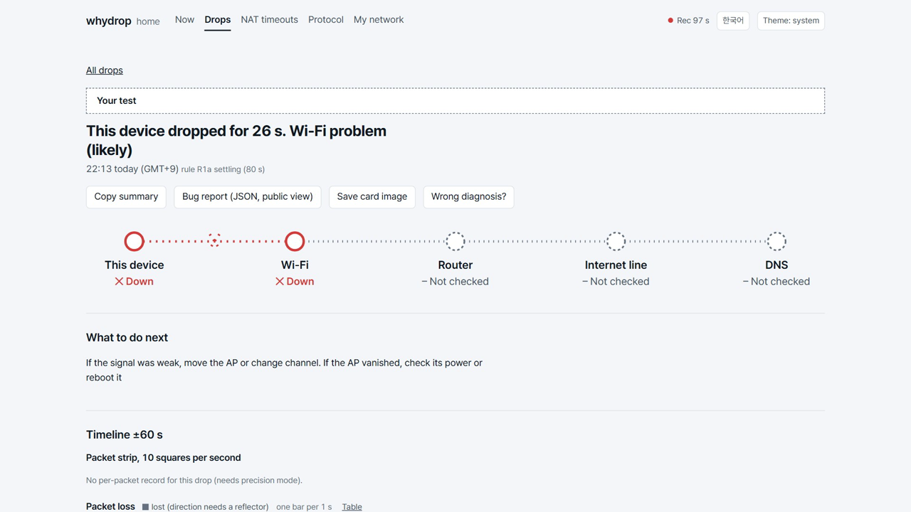
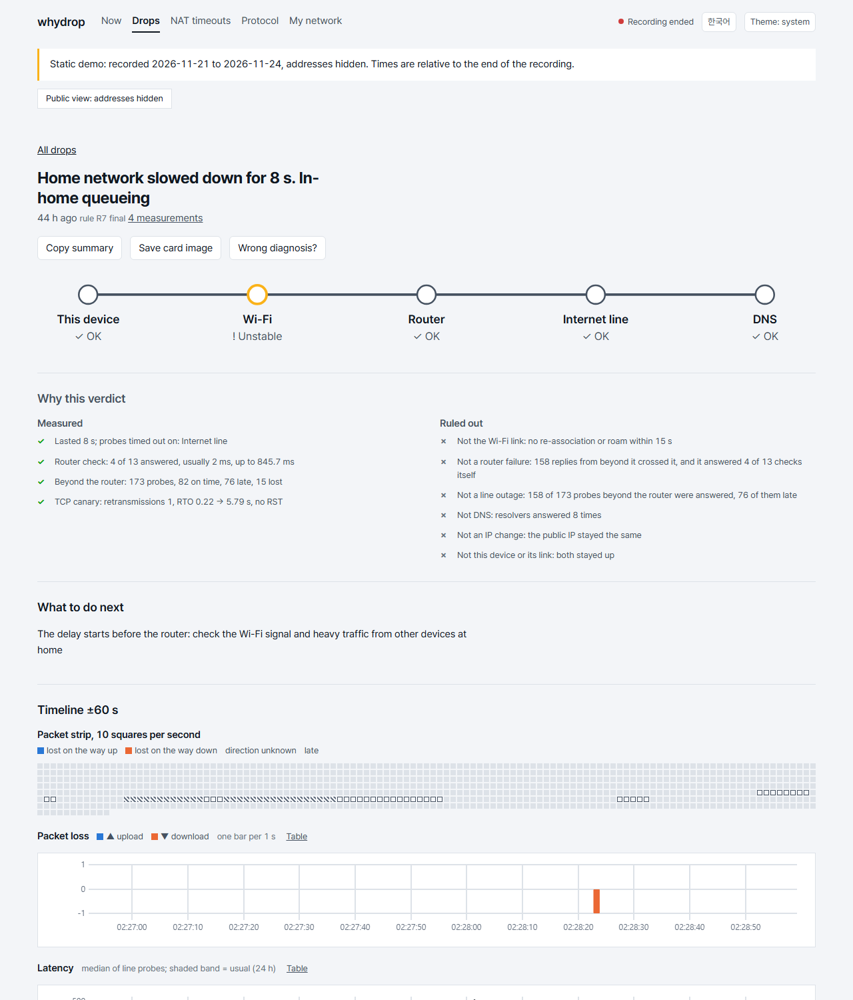
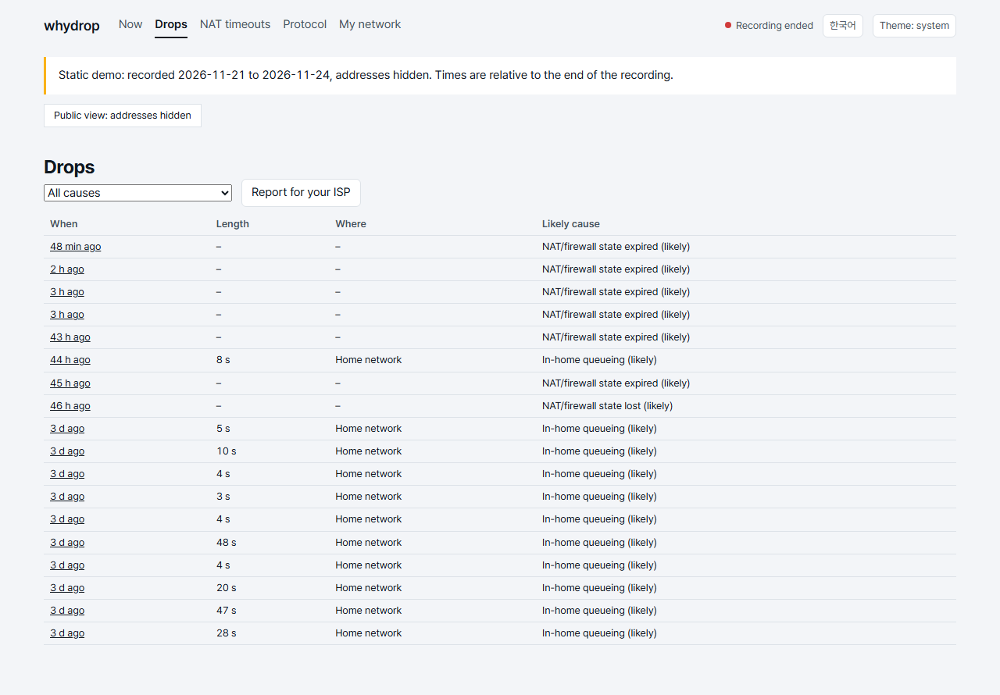
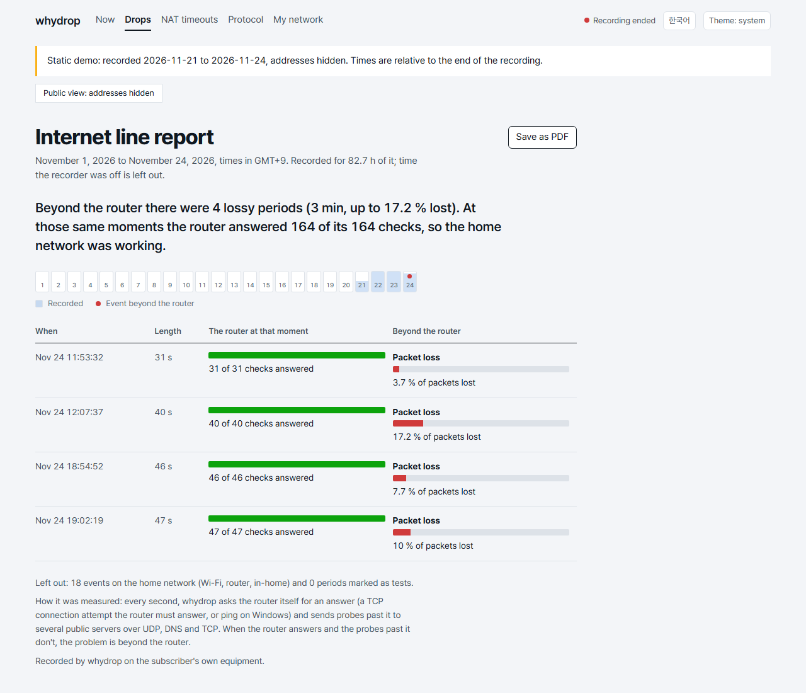
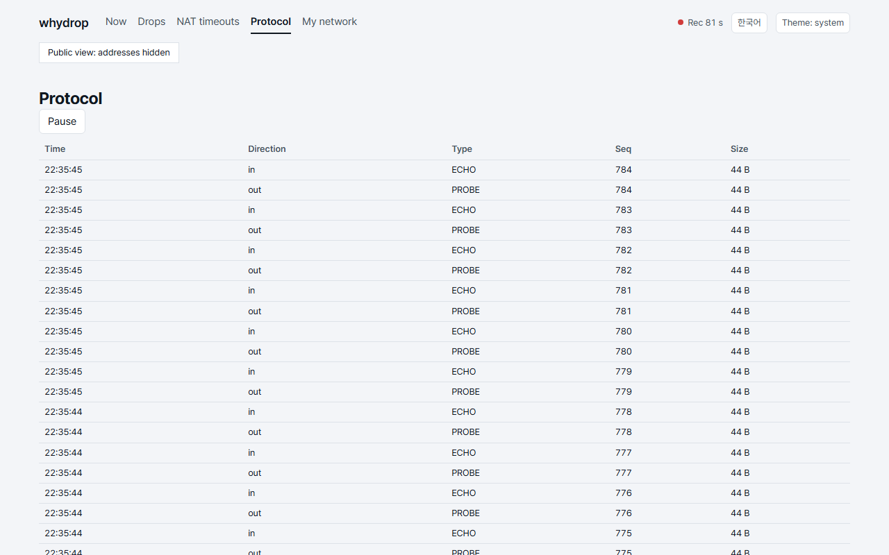
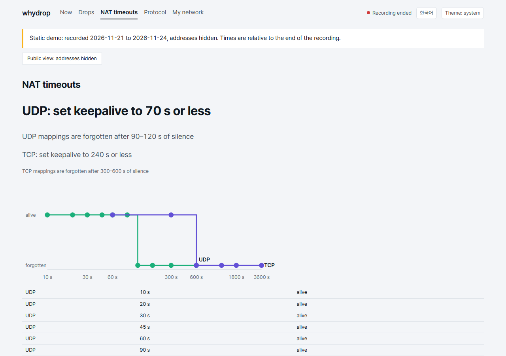
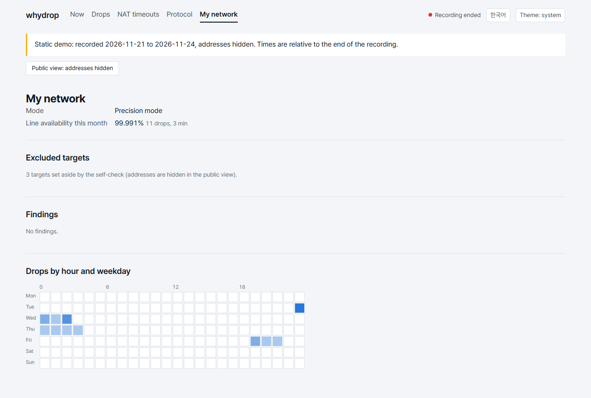

# Using whydrop, step by step

[한국어](usage.ko.md)

This guide walks through every part of whydrop on your own machine: install it, watch the dashboard, cause a drop on purpose, read the verdict, then turn on precision mode to see the TCP and UDP protocol at work. Every screenshot is a real recording: the laptop ones from a Windows 11 laptop on 2026-11-27, the others from the [public demo](https://yhk0427.github.io/whydrop/) (three days on a home server, addresses hidden).

1. [What you need](#1-what-you-need)
2. [Install and start](#2-install-and-start)
3. [The first minute on the dashboard](#3-the-first-minute-on-the-dashboard)
4. [Make a drop on purpose](#4-make-a-drop-on-purpose)
5. [Read a drop](#5-read-a-drop)
6. [All drops, and a report for your ISP](#6-all-drops-and-a-report-for-your-isp)
7. [Precision mode: watch the TCP/UDP protocol](#7-precision-mode-watch-the-tcpudp-protocol)
8. [NAT timeouts](#8-nat-timeouts)
9. [My network](#9-my-network)
10. [Alerts, exports and other tools](#10-alerts-exports-and-other-tools)
11. [Stop, where the data is, uninstall](#11-stop-where-the-data-is-uninstall)
12. [When something goes wrong](#12-when-something-goes-wrong)

## 1. What you need

- **Basic mode** (sections 2 to 6, 9): one computer on the connection you want to watch, Git, and Python 3.11 to 3.14. Nothing else: no account, no server, no configuration.
- **Precision mode** (sections 7 and 8): also a **reflector**, a small whydrop process the agent talks to over its own UDP and TCP protocol. To *measure* your line it has to be on the other side of the internet (a cheap VPS; a free tier is enough). To *see the protocol work* it can run on the same laptop (section 7.2).

Windows (native) and Linux are tested. macOS hasn't been tried yet. Docker is for always-on Linux servers; Docker Desktop on Windows/macOS and WSL are refused on purpose, because they would measure their VM's virtual network instead of yours.

## 2. Install and start

**Windows** (PowerShell):

```powershell
git clone https://github.com/YHK0427/whydrop; cd whydrop
py -m venv .venv
.venv\Scripts\pip install ".[web]"
.venv\Scripts\whydrop agent
```

**Linux**:

```sh
git clone https://github.com/YHK0427/whydrop && cd whydrop
python3 -m venv .venv && .venv/bin/pip install '.[web]'
.venv/bin/whydrop agent
```

`.[web]` installs the dashboard (FastAPI, uvicorn). The agent, the probes and the reflector themselves use only Python's standard library.

After a few seconds the terminal prints three lines:

```
INFO whydrop.agent self-check ok; excluded: none
INFO whydrop.agent watching: mode=basic link=wifi gateway=x.x.x.1 isp_dns=unknown excluded=none
INFO whydrop.agent dashboard: http://127.0.0.1:8790/
```

- **self-check**: before it records anything, whydrop checks that each target it will probe actually answers from your network (the router, public STUN and DNS servers, TCP to a few large sites). Targets that never answer are *excluded* instead of being counted as lost forever.
- **watching**: the mode (`basic` or `precision`), how you're connected (`wifi` or `wired`), the router (addresses are masked in logs), and your ISP's DNS if it could find it.
- **dashboard**: open this address in a browser on the same computer. No token is needed there; one is needed only if you make the dashboard listen beyond this machine (`WHYDROP_WEB_BIND`).

Leave the terminal open: closing it stops the recording.

**On an always-on Linux server**, where whydrop is meant to live, use Docker instead: see [Quick start](../README.md#quick-start) in the README.

## 3. The first minute on the dashboard

Open <http://127.0.0.1:8790/>. The page is **Now**.



From top to bottom:

1. **One sentence** about right now. For the first ~30 s it says "Checking your network…" while the self-check runs; then "Everything is working." or, during a drop, "Wi-Fi is down right now (17 s so far)."
2. **The path**, five hops from your computer outwards. Each hop is judged from its own probes:

   | Hop | What it watches |
   |---|---|
   | This device | your computer still has an address and a route |
   | Wi-Fi (or Cable) | association and signal (`netsh` on Windows, `iw` on Linux); the dBm shown is the current signal |
   | Router | the router answers a check every second |
   | Internet line | probes that go *through* the router to several independent providers (STUN, DNS, TCP connect; in precision mode also the reflector) |
   | DNS | name lookups through your router, your ISP's resolvers and public ones |

   A broken hop turns red and the line breaks there. Click a hop to list the past drops at that hop.
3. **Last 1 h / 6 h / 24 h / 7 d** set the range of the charts below. **Start a 2-minute test** is section 4.
4. **Packet loss**: lost probes per bar. In basic mode it can't tell the direction; in precision mode upload is drawn above the line (blue ▲) and download below it (orange ▼).
5. **Latency**: the median of the line probes. After the first hour a grey band shows what's usual for this network (the 10th percentile over 24 h); until then it says "Learning what's usual for this network."
6. **TCP connection** (precision mode): the state of a TCP connection kept open to the reflector, every second: OK, stall, or RST.
7. **Recent drops** and **Rough patches** (periods of loss or high latency that weren't outages).

Every **Table** link shows the same numbers as a table, for screen readers or copying. **한국어** switches the whole dashboard to Korean; **Theme** cycles light, dark and system.

## 4. Make a drop on purpose

You don't have to wait for your internet to fail to see whydrop work:

1. On **Now**, press **Start a 2-minute test**. The next 2 minutes are labelled "Your test", so this drop stays apart from real ones (and out of the ISP report).
2. Switch Wi-Fi off, wait about 10 seconds, switch it back on. (On a wired computer, unplug the cable.)
3. Watch the page; no need to reload.



**Why it appears about 15 s late.** whydrop decides each second about 14 s after it happened, on purpose: a probe that comes back late still proves the path worked, so it waits for late replies before it calls anything lost. That is why a slow-but-working moment isn't reported as an outage. The headline then counts from the real start ("17 s so far").

When Wi-Fi comes back, the drop appears under **Recent drops** with its length, the hops that were down, the likely cause and the "Your test" tag.

## 5. Read a drop

Click a drop (on **Now** or **Drops**). The laptop test from section 4:



And a real one from the public demo, an 8-second slowdown in precision mode:



What's on the page:

- **The headline**: which hop, how long, and the likely cause, e.g. "Home network slowed down for 8 s. In-home queueing". Under it, the rule that decided (R1a, R7, …; all rules are in [design](design.md#cause-rules)) and its state: *settling (80 s)* while late evidence can still change it, then *final*.
- **Copy summary**: a few lines of plain text for a chat or a ticket. **Bug report (JSON, public view)**: ±10 minutes of everything recorded, with your addresses hidden, to attach to an issue. **Save card image**: a 1200×630 image of this drop in public-view words, for sharing. **Wrong diagnosis?** opens a prefilled GitHub issue.
- **The path** at the moment of the drop. Hops beyond a broken one show "Not checked", because nothing could reach them.
- **Why this verdict**: **Measured** lists the facts the verdict rests on (how long, the router's answers and RTT, how many probes beyond the router came back on time, late or not at all, TCP retransmissions and RST). **Ruled out** lists each other cause and the measurement that excludes it.
- **What to do next**: one sentence for this cause.
- **Timeline ±60 s**: the minute before and after.
  - **Packet strip, 10 squares per second** (precision mode): every UDP packet of the stream, one square each; the legend marks those lost on the way up (blue), lost on the way down (orange), lost with the direction unknown, and late.
  - **Packet loss** and **Latency**, one bar per second.
  - **TCP connection**: what TCP itself did (stalls, retransmissions with the timeout doubling, a reset or not).
- **In protocol terms** (precision mode): the same drop told in sequence numbers, RTO and RST.
- **Evidence**, **Settled cause history** (if the cause changed while settling) and **Annotations** (your test, or a period you labelled).

## 6. All drops, and a report for your ISP

**Drops** lists every drop in the range, newest first: when, how long, where, likely cause. Filter by cause with the menu, or by hop by clicking it on the path.



**Report for your ISP** opens a printable page for this month with only what happened *beyond* your router (line drops, slowdowns, lossy periods, public IP changes, ISP DNS failures). Each event is set against the router's answers at that same moment, so "please restart your router" is already answered. Home-network problems and your test periods are counted, not listed. **Save as PDF** prints it on A4; **Download as text** gives the plain-text form.



## 7. Precision mode: watch the TCP/UDP protocol

### 7.1 What it adds

Basic mode only knows "a reply came back or it didn't". With a reflector, the agent adds three streams of its own protocol (byte layout in [protocol](protocol.md)):

| Stream | Transport | What it shows |
|---|---|---|
| **udp_stream** | UDP, 10 packets a second, each with a sequence number | The reflector reports which sequence numbers it received, so every lost packet is placed: lost **on the way up** (the reflector never got it) or **on the way down** (it got it, its echo was lost) |
| **Hot TCP connection** | TCP, a heartbeat every second | What TCP does during a drop: stalls, retransmissions with the RTO doubling, a reset, the reconnect |
| **Idle TCP canary** | TCP, silent for minutes | Whether a NAT or firewall on the way silently forgets idle connections |

Both ends share a secret (`WHYDROP_SECRET`, at least 32 bytes). Every packet carries an HMAC, and the reflector never answers anything it can't verify.

### 7.2 Try it on one laptop (to see the protocol)

This runs the reflector and the agent on the same computer. **The packets never leave the machine** (they go over 127.0.0.1), so this measures nothing about your network: switching Wi-Fi off won't make these packets fail. What it shows is the protocol itself working: the sequence-numbered UDP stream, the TCP heartbeat, the HMAC, and the dashboard's precision views.

First stop the basic agent (Ctrl+C in its terminal). Then, in the `whydrop` folder:

**Terminal 1 — the reflector** (Windows PowerShell):

```powershell
.venv\Scripts\python -c "import secrets; print(secrets.token_hex(32))" > $env:TEMP\whydrop-secret
$env:WHYDROP_SECRET = Get-Content $env:TEMP\whydrop-secret
.venv\Scripts\whydrop reflector --host 127.0.0.1
```

It prints `whydrop reflector 0.6.2 listening udp :48100 tcp :48100`.

**Terminal 2 — the agent in precision mode**:

```powershell
$env:WHYDROP_SECRET = Get-Content $env:TEMP\whydrop-secret
$env:WHYDROP_REFLECTOR = "127.0.0.1"
.venv\Scripts\whydrop agent
```

On Linux the same with `export WHYDROP_SECRET=$(cat /tmp/whydrop-secret)` and `.venv/bin/whydrop`.

The agent now prints `mode=precision`. On **Now**, packet loss gets its upload/download legend and the **TCP connection** lane fills in green (the screenshot in section 3 is this setup). Open **Protocol**:



Each row is one packet: **PROBE** going out, **ECHO** coming back with the same sequence number, 44 bytes each (a 36-byte body plus an 8-byte HMAC). Click a row to see its bytes in hex with every field named as in [protocol](protocol.md). **Pause** freezes the list. To look at the same packets in Wireshark, load the dissector in [contrib/wireshark](../contrib/wireshark) and capture on the loopback adapter, port 48100.

### 7.3 Measuring your line for real

Run the reflector on a machine across the internet: [deploy-reflector](deploy-reflector.md) has the steps for a VPS (Docker or plain Python; one open port, UDP and TCP 48100). Then start the agent with the same secret and `WHYDROP_REFLECTOR=<that host>`. Now a drop on your line shows which way the packets were lost, and the packet strip in section 5 fills in.

## 8. NAT timeouts

Routers and firewalls forget a connection that stays silent for too long, and apps that keep connections open (games, VoIP, VPNs, chat) then break without warning. The **NAT timeouts** page measures how long your path keeps an idle UDP mapping (10 s to 10 min) and an idle TCP connection (1 min to 1 h), and recommends a keepalive.



Press **Run NAT test** (or run `whydrop nat-test` in a terminal while the agent runs; `--udp-only`, `--tcp-only`, `--max-delay N`). All delays run in parallel, so the full test takes as long as its longest delay. It needs precision mode with a reflector **across a NAT**: on one laptop (7.2) there's no NAT in between, so every delay simply survives.

## 9. My network



- **Mode**: basic or precision.
- **Line availability this month**: the share of time the line beyond the router was up, with the number of drops and their total length.
- **Excluded targets**: what the self-check set aside and why (e.g. a DNS server your network blocks).
- **Findings**: lasting observations, such as probes leaving through a VPN, or the reflector rejecting our secret.
- **Drops by hour and weekday**: when drops tend to happen.

## 10. Alerts, exports and other tools

**Alerts.** Create `whydrop.toml` in the folder you start the agent from (every key is documented in [`whydrop.example.toml`](../whydrop.example.toml)):

```toml
[notify]
webhook_url = "https://ntfy.sh/your-topic"
format = "ntfy"        # or "json", "discord"
lang = "en"            # or "ko"
```

An alert is sent when a drop is final (80 s after it ends; 130 s when Wi-Fi, the cable or the router was down, since nothing can be sent through a dead line anyway), at most 12 an hour, with addresses hidden.

**Exports** (open in the browser while the agent runs):

- `http://127.0.0.1:8790/api/export/incidents.csv` — drops (also `conditions`, `events`, `samples_1m`; `.json` instead of `.csv`)
- `http://127.0.0.1:8790/api/isp-report?format=json` — the ISP report's numbers
- `http://127.0.0.1:8790/api/metrics` — Prometheus metrics; Grafana and Home Assistant setups in [integrations](integrations.md)

**Other commands:**

| Command | What it does |
|---|---|
| `whydrop annotate --label user-test --start 2026-11-27T22:12:00+09:00 --end …` | label a period (`reproduced`, `injected`, `user-test`) so its drops are tagged |
| `whydrop replay whydrop-data/whydrop.db` | re-run the analysis over a recording; `--write` updates past verdicts after an upgrade (backs up first) |
| `whydrop export-static whydrop-data/whydrop.db --out site` | write a read-only public copy of the dashboard, like the demo |
| `whydrop --version` | the installed version |

## 11. Stop, where the data is, uninstall

- **Stop**: Ctrl+C in the agent's terminal (or close it).
- **Data**: everything is in `whydrop-data/whydrop.db` (SQLite) in the folder you started from. 1-second data is kept 7 days (±10 minutes around each drop for 90 days), 1-minute data a year. Nothing is sent anywhere unless you set up alerts.
- **Uninstall**: delete the `whydrop` folder.

## 12. When something goes wrong

| What you see | What to do |
|---|---|
| `whydrop refuses to start in a VM-backed Docker` | You ran it in Docker Desktop or WSL. Use the steps in section 2 instead |
| `requires a different Python` from pip | Use Python 3.11 to 3.14, e.g. `py -3.13 -m venv .venv` |
| `dashboard off: can't listen on 127.0.0.1:8790` | Something else uses the port. Set `$env:WHYDROP_WEB_BIND = "127.0.0.1:8791"` (Linux: `export …`) and start again |
| The dashboard asks for a token | You opened it through a network address rather than 127.0.0.1. The token is in `whydrop-data/ui-token` |
| "Checking your network…" for a while | The self-check takes up to ~30 s, and it runs again after the network changes |
| A drop shows up ~15 s after it started | Expected: see section 4 |
| No Wi-Fi details on Windows in another language | Signal and AP are read from `netsh` in English and Korean; other languages still get connected/disconnected |

More background: [how it works](how-it-works.md), [design](design.md) (every rule and threshold), [protocol](protocol.md).
